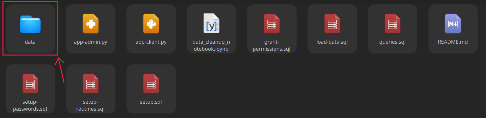
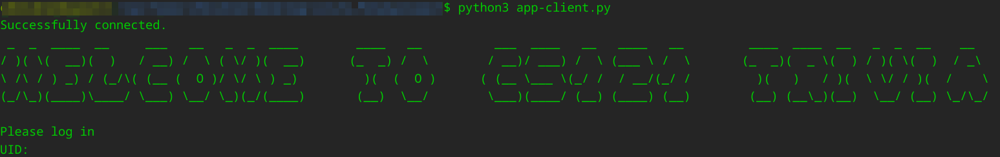
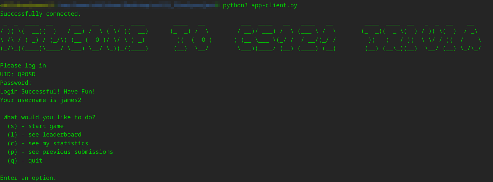
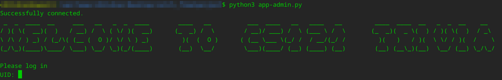
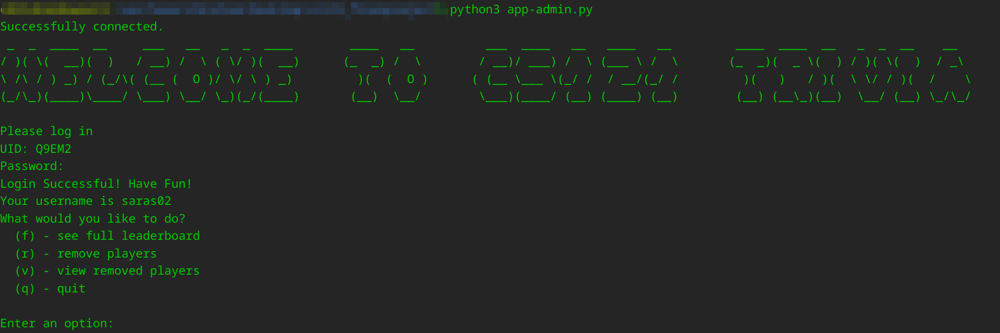

# CS121 Trivia Game Final Project

**Contributors: Saraswati Soedarmadji and Pat Mutia**

## Table of Contents


- [CS121 Trivia Game Final Project](#cs121-trivia-game-final-project)
  - [Table of Contents](#table-of-contents)
  - [1. Overview](#1-overview)
  - [2. Trivia Dataset](#2-trivia-dataset)
  - [3. Loading Data from the Command Line](#3-loading-data-from-the-command-line)
  - [4. Python Dependencies](#4-python-dependencies)
  - [5. Running the Python Program, What to Expect](#5-running-the-python-program-what-to-expect)
    - [5.1 Client users](#51-client-users)
    - [5.2 Admin users](#52-admin-users)

## 1. Overview

This is the final project for the Caltech CS121 course. In this final project, we implement an interactive trivia game application. This application supports both admin users and client users. The application supports playing the trivia game, viewing leaderboards, viewing player statistics, submission histories, and removing players (only available to admins). Admin users are allowed to do almost anything, except for playing the game (i.e. they are allowed to view the full leaderboard, submission of all players, and remove players if they have broken the rules). Clients are allowed to play games, see the leaderboard (only the top 5, and if they are not in the top 5, then their ranking along with the person one rank above), see their statistics, and see all their previous submissions. Details about the trivia dataset, how to run the code, and what to expect when playing are outlined in detail below. Have fun :)!

## 2. Trivia Dataset 

For the trivia questions/answers, we are working with data obtained from the [Open Trivia Website](https://opentdb.com). We chose to obtain our data from this website since it had some very desirable (basic) attributes for the trivia application (specifically questions, answers, category, and difficulty) that most other trivia datasets did not contain that were easy to build on (i.e. we didn't have to go through each question one by one and add a category for example). One drawback of the data is that it was not very convenient to obtain, as we were only able to query the data in 50 question/category/answer files in `.json` format, so we had to query from this website 75 times to get a total of 3750 data entries.

To clean up the data, we first re-ordered some attributes (split answers that originally came in a list into multiple columns for the use of multiple choice, shuffle answers, etc …) and generated new attributes based on original attributes (such as correct answer for multiple choice) so that it would be more appropriate for our application. We also gave each question a unique 7-digit question id so it would be easier to reference a question in the future. Finally, we filtered out duplicate entries from this dataset (since we queried from the website several times, and each query was independent from each other, we had some duplicates). In the end, we were left with 2475 unique entries in our questions/answers data set. Note that all of the data cleanup was done in Python with the help of the `Pandas` library and `Numpy` library. Specifics on the data cleanup procedure are provided in the `data_cleanup.ipynb` notebook in our submission.

For the `user_info` dataset, we generated a total of 60 random users with randomized names (chosen from a list of most popular names), unique 5-digit ids generated using `Numpy` library in Python, unique passwords (randomized strings), and randomized scores. The goal of having this data set of “dummy” users is so that when a player actually plays the game and enter the leaderboard, they will be able to have people to compare their scores against instead of having an empty leaderboard with nobody to compare against (and no goal to beat), and always place first.

## 3. Loading Data from the Command Line

In this section, we describe how to load the data from the command line. First, please make sure that you have MySQL downloaded and available through your device's command line. Note not to include the `mysql>` prompt when copying the commands below into the command line.

First, create the appropriate database called `triviadb` using the commands listed below.

```sql
mysql> CREATE DATABASE triviadb;
mysql> USE triviadb;
```

After creating the database, we will load the data, create users for the game, create functions and procedures that will be used when running the game, grant permissions for MySQL accounts, and run all the queries. Follow the commands listed below

```sql
mysql> SOURCE setup.sql;
mysql> SOURCE load-data.sql;
mysql> SOURCE setup-passwords.sql;
mysql> SOURCE setup-routines.sql;
mysql> SOURCE grant-permissions.sql;
mysql> SOURCE queries.sql;
```
:exclamation: :exclamation: Please note that we have changed the inputs to the `sp_add_user` file to take in `user_id, username, admin_bol,` and `password`, so the starter code provided in `pw-tester.sql` to test this procedure will not work. The `authenticate` function has also been changed to take in `user_id` instead of `username`. However, we have provided code at the bottom of this file to test these functions. 

:exclamation: :exclamation: Please note that for the `load-data.sql` file to run successfully, it is required that all the csv files are put into a separate folder in the same directory called `data`. This is important as `load-data.sql` file will not run properly if the data is in the wrong folder. The file organization should look similar to what is shown in the picture below. Notice that there is a separate `data` folder highlighted in red containing four `.csv` files `accounts.csv`, `leaderboard.csv`, `submission_history.csv`, and `trivia_questions_combined.csv`. 



## 4. Python Dependencies

Before playing the trivia game, please make sure that you have Python installed on your computer. In addition, please also make sure that you install the required dependencies listed in the commands below.

```
mysql> quit; # to exit out of the mysql command line
$ pip3 install mysql-connector-python
$ pip3 install art
$ pip3 install DateTime
$ pip3 install getpass
$ pip3 install --upgrade pandas
```

:exclamation: Note that if you don't have `pip3`, replacing it with `pip` should also work.

## 5. Running the Python Program, What to Expect

After installing all the Python dependencies above, we are ready to run the python script and play the game! There are two python scripts, one for clients (players), and one for admins. The different ways to run the scripts and what to expect for each user is listed below:

### 5.1 Client users

To play the game as a user/client, please run the Python script `app-client.py` by inputting the following command into your command line:

```
$ python3 app-client.py
```

If the clien app started successfully, you should see the following start-up screen in your command line.



Once you see this startup screen, the application will ask you to input your user ID and password to log into the application. The following accounts are registered for the client application:

| UID   | Username | Password   |
|-------|----------|------------|
| QPOSD | james2   | qpassword1 |
| 1KF2J | mario243 | passwords  |
| O2I5J | player2  | 1password1 |

:exclamation: Note that the application only asks for your user ID (UID) and password, not username. Please only use the 5-digit UID listed above to login. In addition, the application also only allows for a maximum of 5 incorrect attempts before quitting the application, so make sure that the UIDs and passwords are inputted correctly!

Once you have successfully logged in, the application will print out a success message, and you are ready to play! You will be prompted with choices of what to do within the application. Your screen should look like the image below.



As a client, you can play a game, see the leaderboard, see your statistics, view your previous submissions, or quit the application. To select an option, please type the letter in the parenthesis on the left next to the command description. Have fun!

### 5.2 Admin users

To play the game as an admin, please run the Python script `app-admin.py` by inputting the following command into your command line:

```
$ python3 app-admin.py
```

If the admin app started successfully, you should see the following start-up screen in your command line.



Once you see this startup screen, the application will ask you to input your user ID and password to log into the application. The following accounts are registered for the admin application:

| UID   | Username | Password  |
|-------|----------|-----------|
| Q9EM2 | saras02  | adminpass |
| WE3L9 | pat190   | admin2    |

:exclamation: Note that the application only asks for your user ID (UID) and password, not username. Please only use the 5-digit UID listed above to login. In addition, the application also only allows for a maximum of 5 incorrect attempts before quitting the application, so make sure that the UIDs and passwords are inputted correctly!

Once you have successfully logged in, the application will print out a success message, and you are ready to play! You will be prompted with choices of what to do within the application. Your screen should look like the image below.



As an admin, you can see the full leaderboard, remove players, view the list of all removed players (and the time of removal), and quit the application. Your screen should look like the image below. To select an option, please type the letter in the parenthesis on the left next to the command description. Have fun! 